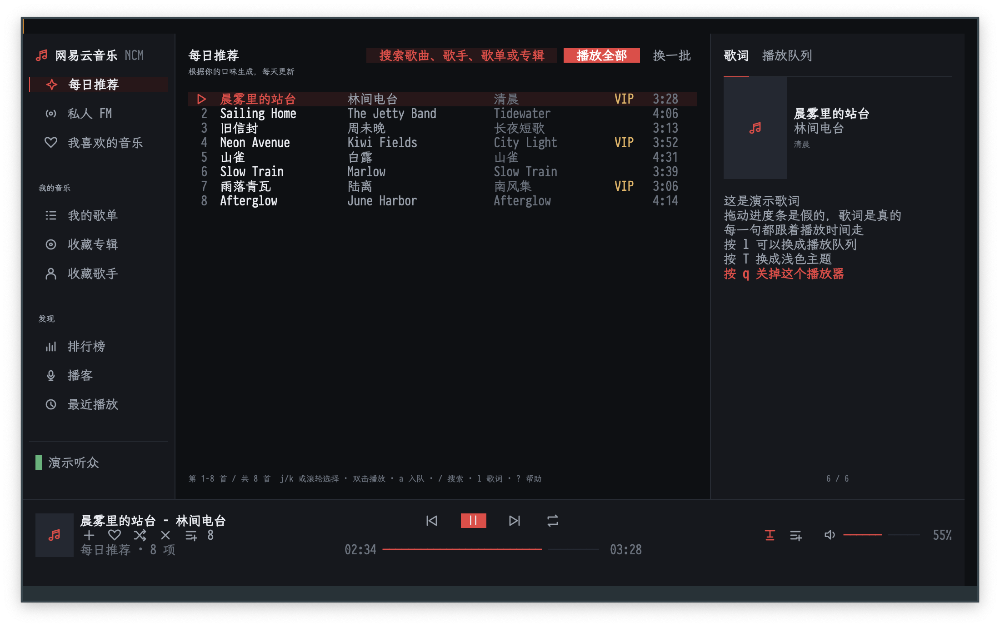
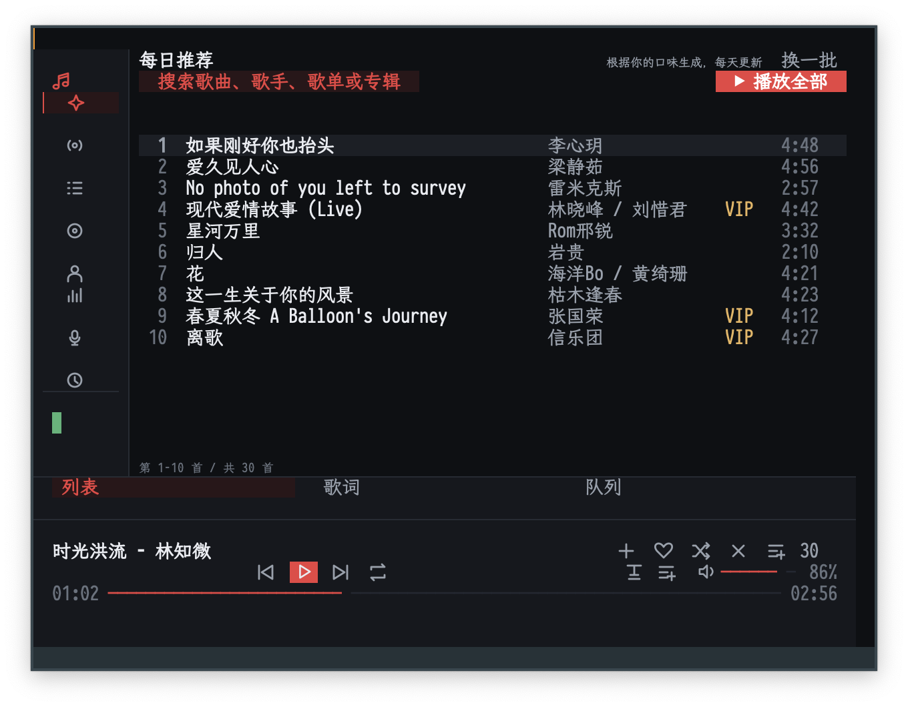
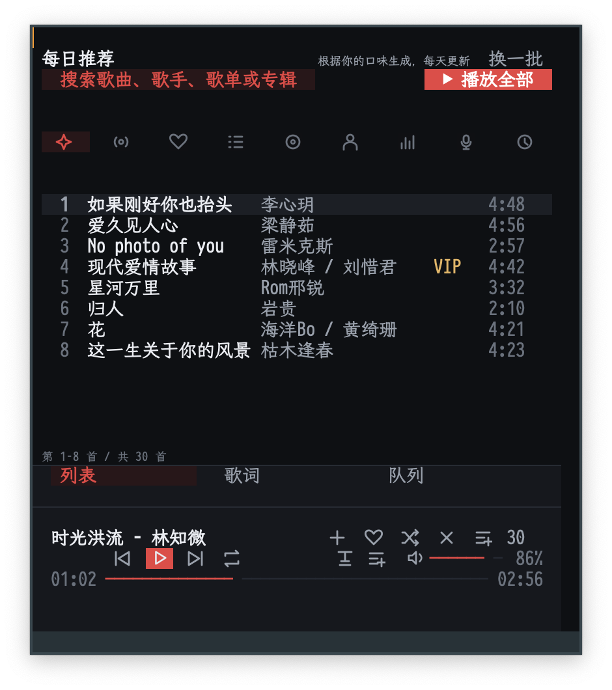

# ETAF NCM

ETAF NCM is a NetEase Cloud Music client for Emacs. It renders the signed-in
account's music library, playback and lyric as one ETAF view: a sidebar of
libraries, a paginated song list, a panel with the synchronized lyric or the
queue, and a playback bar. mpv keeps playing; the player is the interface over
the `netease-music` backend.

The player at a wide frame:



At a medium frame the sidebar becomes an icon rail and the side pane turns
into tabs:



At a narrow frame the libraries become a chip strip and the panes stack under
tabs:



## Capabilities

- Libraries: daily recommendation, private FM, liked songs, playlists, saved
  albums and artists, charts, podcasts, recent plays.
- Search by song, with a playlist scope; results behave like any library.
- Playback: play a row or a whole list, pause, skip, stop, volume, relative
  seek, shuffle, repeat, like and unlike.
- Local library: inline download and queue icons act directly, without menus.
  The `d` key downloads the selection; a check marks local songs. The next queue plays the
  local file instead of fetching a fresh stream URL.
- Queue: a window that follows the playing song, wheel through every loaded
  entry, jump to any of them, append songs.
- Lyric: LRC parsed into timed lines, current line highlighted, translation
  shown next to it when the backend has one.
- Two palettes (dark and light) with one key, published as `:ui-*` theme tokens
  so the shared ETAF UI controls follow the same colours.
- Headless sessions for scripts and tests: no buffer, no timer and a scripted
  client are all supported.
- Window layouts: three columns on a wide frame, a glyph-only rail with one pane
  on a medium one, and a phone-like stacked layout on a narrow one.

## Prerequisites

| Requirement | Why | Check |
| --- | --- | --- |
| Emacs 29.1 or newer | the ETAF runtime | `emacs --version` |
| Node.js | runs the backend scripts | `command -v node` |
| mpv | plays the audio | `command -v mpv` |
| `etaf`, `etaf-ui`, `ebox`, `ecss` | the framework; each repository's root entry must be on `load-path` | every checkout is readable |
| `netease-music` backend | library, playback, lyric and login | `netease-music check` or its `scripts/` directory exists |

The player is the interface only: the backend owns the account, the queue file
and mpv.  Install and sign in to the backend first, then the Emacs package.

## Installation

### 1. System tools

```sh
brew install node mpv            # macOS; Debian: apt install nodejs mpv
```

`python3` and `qrencode` are optional and only used by the QR login; the SMS
login needs neither.

### 2. The `netease-music` backend

When the skill directory is already on the machine (for example
`~/.pi/agent/shared/skills/netease-music` from a Pi checkout), put its CLI on
`PATH` and run its self-check:

```sh
/path/to/netease-music/scripts/install-cli.sh   # links ~/.local/bin/netease-music
export PATH="$HOME/.local/bin:$PATH"            # or call it through pi-skill
netease-music check                             # dependencies + login state
```

Log in once; the cookie stays local to this machine:

```sh
netease-music login --sms <phone>               # sends a code, then
netease-music login --sms <phone> --sms-code <code>
# or scan a QR code with the NetEase Cloud Music app:
netease-music login
```

The login, queue and saved queues live in the skill's state directory
(`~/.pi/agent/local/skills/netease-music` by default).  A standalone install
can point the skill at its own directory with `NETEASE_MUSIC_STATE_DIR`.

### 3. The Emacs package

```elisp
(add-to-list 'load-path "/path/to/etaf")
(add-to-list 'load-path "/path/to/etaf-ui")
(add-to-list 'load-path "/path/to/ebox")
(add-to-list 'load-path "/path/to/ecss")
(add-to-list 'load-path "/path/to/etaf-ncm")
(require 'etaf-ncm)

(global-set-key (kbd "C-c m") #'etaf-ncm-open)
```

When the backend is not in the default location, point the app at it:

```elisp
(setq etaf-ncm-skill-directory "/path/to/netease-music"
      etaf-ncm-state-directory "~/.local/state/netease-music")
```

`M-x etaf-ncm-open` mounts the player in the selected window; `q` / `M-x
etaf-ncm-close` closes the window and keeps the backend playing, while `Q` /
`M-x etaf-ncm-quit` stops the backend player and closes.  Exiting Emacs stops
a player the app started.  `etaf-ncm-theme-mode` (`dark` or `light`) selects
the palette, and `etaf-ncm-refresh` (or `g` in the player) reloads the
library, playback truth, queue and account.

### Quick start for an agent

A non-interactive path to a working player (the login itself needs the user's
phone or QR scan once):

```sh
command -v node mpv || brew install node mpv
SKILL="${ETAF_NCM_SKILL_DIR:-$HOME/.pi/agent/shared/skills/netease-music}"
test -x "$SKILL/scripts/netease-music.sh" || {
  echo "netease-music backend not found: $SKILL" >&2; exit 1; }
"$SKILL/scripts/netease-music.sh" check || "$SKILL/scripts/netease-music.sh" login
```

```elisp
;; After adding the five repositories to `load-path':
(require 'etaf-ncm)
(etaf-ncm-open)                  ; real backend; returns the player buffer
```

A missing script, mpv or login leaves the player mounted with the backend
error in its message line; `g` retries after the backend is fixed.

## Minimal example

```elisp
(require 'etaf-ncm)

(let* ((player (etaf-ncm-create))          ; headless session
       (client (etaf-ncm-make-client)))
  (plist-put player :client client)
  (etaf-ncm-refresh player)                ; library, status, queue, account
  (while (plist-get (etaf-ncm-state player) :loading)
    (sit-for 0.05))
  (etaf-ncm-move-selection player 4)
  (etaf-ncm-activate-selection player)     ; plays the fifth row
  (plist-get (etaf-ncm-state player) :status))
```

## Runnable demo

`M-x etaf-ncm-demo-open` mounts the complete player on a scripted library, so it
needs no network, login or mpv. `M-x etaf-ncm-demo-live` opens the same player
against the installed backend. From a checkout with sibling providers:

```sh
cd etaf-ncm
emacs -Q -L ../../ecss -L ../../ebox -L ../../etaf -L ../../etaf-ui \
  -L . -l examples/etaf-ncm-demo.el -f etaf-ncm-demo-open
```

## Documentation

- [The manual](docs/manual.md): keys, libraries, playback, lyric, theming,
  scripting, custom backends and troubleshooting.
- [Architecture](docs/architecture.md): module responsibilities, data flow and
  invariants.
- [The root entry Commentary](etaf-ncm.el): the authoritative list of supported
  functions, variables, the app Component and the error type.

## Checks

`make check` runs the structure checker, byte compilation with warnings as
errors, the acceptance suite and the API boundary checker. The acceptance
scenarios drive a scripted backend, so they need no network, mpv or frame:

```sh
make compile   # byte compilation, warnings are errors
make test      # the public acceptance scenarios
make check     # structure + compile + acceptance + API boundary
```
