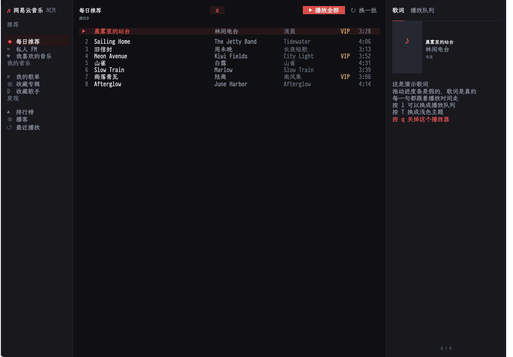

# ETAF NCM

ETAF NCM is a NetEase Cloud Music client for Emacs. It renders the signed-in
account's music library, playback and lyric as one ETAF view: a sidebar of
libraries, a paginated song list, a panel with the synchronized lyric or the
queue, and a playback bar. mpv keeps playing; the player is the interface over
the `netease-music` backend.



## Capabilities

- Libraries: daily recommendation, private FM, liked songs, playlists, saved
  albums and artists, charts, podcasts, recent plays.
- Search by song, with a playlist scope; results behave like any library.
- Playback: play a row or a whole list, pause, skip, stop, volume, relative
  seek, shuffle, repeat, like and unlike.
- Queue: the entries around the playing song, jump to any of them, append songs.
- Lyric: LRC parsed into timed lines, current line highlighted, translation
  shown next to it when the backend has one.
- Two palettes (dark and light) with one key, published as `:ui-*` theme tokens
  so the shared ETAF UI controls follow the same colours.
- Headless sessions for scripts and tests: no buffer, no timer and a scripted
  client are all supported.
- Window layouts: three columns on a wide frame, a glyph-only rail with one pane
  on a medium one, and a phone-like stacked layout on a narrow one.

## Prerequisites

Emacs 29.1 or newer, the `etaf`, `etaf-ui`, `ebox` and `ecss` repositories on
`load-path`, and the `netease-music` backend skill with Node.js and mpv signed
in to the account.

## Installation

```elisp
(add-to-list 'load-path "/path/to/etaf")
(add-to-list 'load-path "/path/to/etaf-ui")
(add-to-list 'load-path "/path/to/ebox")
(add-to-list 'load-path "/path/to/ecss")
(add-to-list 'load-path "/path/to/etaf-ncm")
(require 'etaf-ncm)

(global-set-key (kbd "C-c m") #'etaf-ncm-open)
```

`M-x etaf-ncm-open` mounts the player; `M-x etaf-ncm-close` closes it.
`etaf-ncm-skill-directory` and `etaf-ncm-state-directory` point at the backend
skill and its login/queue state; `etaf-ncm-theme-mode` selects the palette.

## Minimal example

```elisp
(require 'etaf-ncm)

(let* ((player (etaf-ncm-create))          ; headless session
       (client (etaf-ncm-make-client)))
  (plist-put player :client client)
  (etaf-ncm-refresh player)                ; library, status, queue, account
  (while (plist-get (etaf-ncm-state player) :loading)
    (sit-for 0.05))
  (etaf-ncm-move-selection player 4)
  (etaf-ncm-play player)                   ; plays the fifth row
  (plist-get (etaf-ncm-state player) :status))
```

## Runnable demo

`M-x etaf-ncm-demo-open` mounts the complete player on a scripted library, so it
needs no network, login or mpv. `M-x etaf-ncm-demo-live` opens the same player
against the installed backend. From a checkout with sibling providers:

```sh
cd etaf-ncm
emacs -Q -L ../../ecss -L ../../ebox -L ../../etaf -L ../../etaf-ui \
  -L . -l examples/etaf-ncm-demo.el -f etaf-ncm-demo-open
```

## Documentation

- [The manual](docs/manual.md): keys, libraries, playback, lyric, theming,
  scripting, custom backends and troubleshooting.
- [Architecture](docs/architecture.md): module responsibilities, data flow and
  invariants.
- [The root entry Commentary](etaf-ncm.el): the authoritative list of supported
  functions, variables, the app Component and the error type.

## Checks

`make check` runs the structure checker, byte compilation with warnings as
errors, the acceptance suite and the API boundary checker. The acceptance
scenarios drive a scripted backend, so they need no network, mpv or frame:

```sh
make compile   # byte compilation, warnings are errors
make test      # the public acceptance scenarios
make check     # structure + compile + acceptance + API boundary
```
